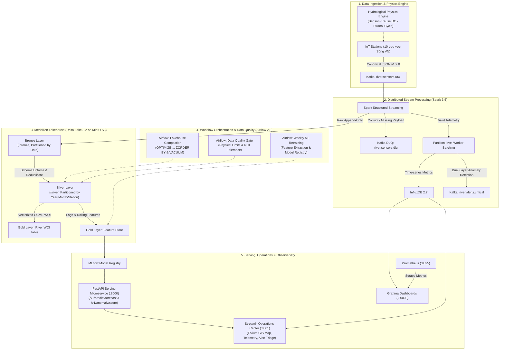

# 🌊 Big Data River Water Quality & MLOps Platform

[](https://github.com/Je-Tiev/BigData-RiverAnalysis/actions/workflows/ci.yml)
[](https://www.python.org/)
[](https://spark.apache.org/)
[](https://kafka.apache.org/)
[](https://delta.io/)
[](https://airflow.apache.org/)
[](https://fastapi.tiangolo.com/)
[](https://streamlit.io/)
[](https://prometheus.io/)
[](https://grafana.com/)
[](https://github.com/astral-sh/ruff)

> **Hệ thống Big Data & MLOps Giám sát Chất lượng Nước Sông Quốc gia theo Tiêu chuẩn Công nghiệp.**  
> Tích hợp Kiến trúc Medallion Lakehouse (Delta Lake), Luồng Xử lý Thời gian thực (Spark Streaming + Kafka), Trí tuệ Nhân tạo Phát hiện Dị thường & Dự báo Quỹ đạo 72h (Machine Learning/MLOps), Bản đồ Không gian GIS (Streamlit Operations Center), và Giám sát Hạ tầng Toàn diện (Prometheus & Grafana).

---

## 👥 Thành viên Dự án (Contributors)

- **Nguyễn Thái Hiếu** - MSSV: 20225127 ([@Hiesu19](https://www.github.com/Hiesu19))
- **Phí Hoàng Việt** - MSSV: 20225429 ([@Je-Tiev](https://github.com/Je-Tiev))
- **Vũ Mạnh Hưng** - MSSV: 20225198 ([@vmh714](https://github.com/vmh714))
- **Hà Huy Dương** - MSSV: 20225183 ([@brown2004](https://github.com/brown2004))
- **Nguyễn Đức Dương** - MSSV: 20225122 ([@duongdeptrai](https://github.com/duongdeptrai))

---

## 📑 Mục lục

1. [Kiến trúc Tổng thể Hệ thống (System Architecture)](#-kiến-trúc-tổng-thể-hệ-thống)
2. [Các Điểm Nâng cấp & Chuẩn hóa Kỹ thuật](#-các-điểm-nâng-cấp--chuẩn-hóa-kỹ-thuật)
3. [Danh mục Cổng Dịch vụ & Giao diện Web (Port Catalog)](#-danh-mục-cổng-dịch-vụ--giao-diện-web)
4. [Hướng dẫn Khởi chạy Nhanh trong 3 Bước (Quickstart)](#-hướng-dẫn-khởi-chạy-nhanh-trong-3-bước)
5. [Cấu trúc Thư mục Dự án (Project Layout)](#-cấu-trúc-thư-mục-dự-án)
6. [Tài liệu Chi tiết Từng Phân hệ](#-tài-liệu-chi-tiết-từng-phân-hệ)
   - [Động học Thủy văn & Producer IoT Simulator](#1-động-học-thủy-văn--producer-iot-simulator)
   - [Streaming Ingestion & Dead Letter Queue (DLQ)](#2-streaming-ingestion--dead-letter-queue-dlq)
   - [Medallion Lakehouse (Bronze -> Silver -> Gold)](#3-medallion-lakehouse-bronze---silver---gold)
   - [Trí tuệ Nhân tạo & MLOps Pipeline](#4-trí-tuệ-nhân-tạo--mlops-pipeline)
   - [FastAPI Model Serving Microservice](#5-fastapi-model-serving-microservice)
   - [Streamlit River Operations Command Center](#6-streamlit-river-operations-command-center)
   - [Giám sát Hạ tầng với Prometheus & Grafana](#7-giám-sát-hạ-tầng-với-prometheus--grafana)
7. [Kiểm thử Tự động & Chất lượng Mã nguồn (CI/CD)](#-kiểm-thử-tự-động--chất-lượng-mã-nguồn)
8. [Vận hành Hệ thống với Makefile & PowerShell](#-vận-hành-hệ-thống-với-makefile--powershell)

---

## 🏛 Kiến trúc Tổng thể Hệ thống

Hệ thống được thiết kế theo mô hình **Decoupled Medallion & Streaming Hybrid Architecture**:



---

## 🚀 Các Điểm Nâng cấp & Chuẩn hóa Kỹ thuật

Hệ thống đã trải qua 5 giai đoạn tái cấu trúc toàn diện so với phiên bản ban đầu:

| Thành phần | Phiên bản Ban đầu (Technical Debt) | Phiên bản Hiện tại (Production-Ready) |
|---|---|---|
| **Driver Memory** | Dùng `batch_df.collect()` gây tràn RAM Driver (OOM) | Phân tán hoàn toàn bằng `foreachPartition` batching tại worker level |
| **Xử lý Dữ liệu Lỗi** | `failOnDataLoss=false`, bỏ qua lỗi âm thầm | **Dead Letter Queue (DLQ)** đẩy dữ liệu rác sang `river.sensors.dlq` |
| **Sinh dữ liệu IoT** | Dùng `random.uniform()` phẳng, phi thực tế | **Hydrological Physics Engine**: mô phỏng nhiệt độ ngày/đêm, hòa tan DO Benson-Krause, 4 kịch bản tiêm dị thường |
| **Lưu trữ Hồ chứa** | Parquet thuần không transaction, bị Small Files Problem | **Delta Lake 3.2.0**: ACID transactions, deduplicate bằng `MERGE INTO`, Airflow `OPTIMIZE ... ZORDER BY` gom file và `VACUUM` |
| **Data Quality Gate** | Không kiểm tra chất lượng dữ liệu | **Declarative Data Quality Auditor**: kiểm toán tỷ lệ null, vi phạm vật lý QCVN 08-MT |
| **Machine Learning** | Không có mô hình AI/ML | **Phát hiện dị thường 2 lớp** (Deterministic QCVN + Multivariate Isolation Forest & Z-Score) & **Dự báo 24h-72h** (95% Confidence Interval) |
| **Phục vụ Mô hình** | Không có REST API | **FastAPI Microservice** chuẩn REST, schema Pydantic, độ trễ < 50ms |
| **Giao diện Giám sát** | Thiếu bản đồ, giao diện thô | **Streamlit Operations Command Center**: Bản đồ GIS 10 trạm sông, realtime Plotly telemetry, AI explorer, Incident triage console |
| **Giám sát Hạ tầng** | Không có monitoring hệ thống | **Prometheus + Grafana Provisioning**: giám sát Kafka lag, Spark executor heap, throughput |
| **CI/CD & DevOps** | Không có CI, không có Makefile | **GitHub Actions CI** tự động lint (Ruff) và chạy 51 unit/integration tests; `Makefile` & `manage.ps1` |

---

## 🌐 Danh mục Cổng Dịch vụ & Giao diện Web

Sau khi khởi chạy `docker compose up -d`, toàn bộ các dịch vụ sẵn sàng tại các cổng:

| Tên Dịch vụ | Cổng Host (URL) | Tài khoản / Mật khẩu | Mục đích Sử dụng |
|---|---|---|---|
| **Streamlit Operations Center** | [`http://localhost:8501`](http://localhost:8501) | *(Không yêu cầu)* | **Giao diện chính cho kỹ sư môi trường**: GIS Map, Telemetry, Dự báo ML, Xử lý sự cố |
| **FastAPI Swagger Docs** | [`http://localhost:8000/docs`](http://localhost:8000/docs) | *(Không yêu cầu)* | REST API Serving: Dự báo 72h, chấm điểm dị thường, kiểm tra sức khỏe hệ thống |
| **Airflow Webserver** | [`http://localhost:8085`](http://localhost:8085) | `admin` / `admin` | Điều phối DAGs: Tối ưu Lakehouse (Compaction), Kiểm toán DQ, Retraining ML |
| **MinIO Storage Console** | [`http://localhost:30001`](http://localhost:30001) | `admin` / `password123` | Quản trị Object Storage S3 cho Delta Lakehouse (`water-quality-lakehouse`) |
| **Grafana Platform Monitor** | [`http://localhost:30003`](http://localhost:30003) | `admin` / `admin123` | Bảng điều khiển giám sát hạ tầng Big Data: Kafka Lag, Spark Processing Time |
| **Kafka UI (Provectus)** | [`http://localhost:8082`](http://localhost:8082) | *(Không yêu cầu)* | Quản lý Kafka Brokers, Topics (`river.sensors.raw`, `dlq`, `alerts`), Consumer groups |
| **Spark Master Web UI** | [`http://localhost:9090`](http://localhost:9090) | *(Không yêu cầu)* | Theo dõi trạng thái cụm Spark, Workers, Running Applications |
| **Spark Worker Web UI** | [`http://localhost:9091`](http://localhost:9091) | *(Không yêu cầu)* | Theo dõi tài nguyên Cores, RAM, Executor thread dump |
| **Prometheus Web UI** | [`http://localhost:9095`](http://localhost:9095) | *(Không yêu cầu)* | Truy vấn PromQL và kiểm tra trạng thái targets cào metric |
| **InfluxDB 2.x Console** | [`http://localhost:8086`](http://localhost:8086) | `admin` / `password123` | Quản trị cơ sở dữ liệu chuỗi thời gian, Token và Bucket |

---

## ⚡ Hướng dẫn Khởi chạy Nhanh trong 3 Bước

### Bước 1: Chuẩn bị Môi trường

```bash
# Clone repository
git clone https://github.com/Je-Tiev/BigData-RiverAnalysis.git
cd BigData-RiverAnalysis

# Khởi tạo file cấu hình môi trường từ mẫu
cp .env.example .env
```

### Bước 2: Khởi động Toàn bộ Hạ tầng bằng 1 Lệnh

Sử dụng Docker Compose hoặc Makefile:

```bash
# Cách 1: Sử dụng Makefile
make up

# Cách 2: Sử dụng PowerShell (trên Windows)
.\manage.ps1 up

# Cách 3: Lệnh Docker Compose trực tiếp
docker compose up -d
```

*(Thời gian khởi động lần đầu khoảng 2-4 phút để build hình ảnh Docker và hoàn tất migration database).*

### Bước 3: Kích hoạt Luồng Sinh Dữ liệu IoT & Mở Giao diện

```bash
# Chạy IoT Simulator sinh dữ liệu cảm biến thủy văn liên tục
make simulator
# hoặc: python src/producers/river_simulator.py
```

Mở trình duyệt truy cập ngay:
- **River Operations Command Center:** [`http://localhost:8501`](http://localhost:8501)
- **FastAPI Interactive API Reference:** [`http://localhost:8000/docs`](http://localhost:8000/docs)
- **Grafana Infrastructure Dashboard:** [`http://localhost:30003`](http://localhost:30003)

---

## 📁 Cấu trúc Thư mục Dự án

```
BigData-RiverAnalysis/
├── .agent/                             # Bộ não theo dõi dự án (Architecture, Tasks, Decisions)
│   ├── architecture_target.md          # Thiết kế kiến trúc mục tiêu
│   ├── decisions_log.md                # 15 Architecture Decision Records (ADR-001 -> ADR-015)
│   ├── project_context.md              # Ngữ cảnh codebase và schema dữ liệu
│   ├── roadmap.md                      # Kế hoạch chi tiết 5 Phase
│   └── tasks.md                        # Checklist theo dõi tiến độ
├── .github/
│   └── workflows/
│       └── ci.yml                      # GitHub Actions CI Workflow (Linting & 51 Pytests)
├── dags/                               # Apache Airflow Orchestration DAGs
│   ├── lakehouse_compaction_vacuum_dag.py # OPTIMIZE ZORDER & VACUUM Delta Lake
│   ├── data_quality_audit_dag.py       # Định kỳ kiểm toán Data Quality Gate
│   └── ml_model_retraining_dag.py      # Tự động hóa retraining & promotion MLflow
├── grafana/                            # Grafana Dashboards & Provisioning
│   ├── dashboards/
│   │   └── bigdata_infrastructure_dashboard.json # Kafka lag, Spark microbatch duration
│   └── provisioning/
│       └── datasources/
│           └── prometheus.yml          # Tự động kết nối datasource Prometheus
├── monitoring/
│   └── prometheus/
│       └── prometheus.yml              # Cấu hình scrape Kafka, Spark, InfluxDB, FastAPI
├── src/                                # Toàn bộ Mã nguồn Nền tảng
│   ├── config/
│   │   └── settings.py                 # Centralized Configuration (Pydantic / Dataclasses)
│   ├── contracts/
│   │   └── river_schema.py             # Data Contract Canonical Schema v1.2.0 & 10 GPS Stations
│   ├── dashboard/
│   │   └── app.py                      # Streamlit Command Center (GIS, Telemetry, ML, Alert)
│   ├── lakehouse/                      # Kiến trúc Medallion Lakehouse (Delta Lake)
│   │   ├── bronze.py                   # Ingest nguyên trạng Kafka JSON append-only
│   │   ├── silver.py                   # Clean, validate, enrich, MERGE INTO deduplication
│   │   └── gold.py                     # Vectorized CCME WQI & ML Feature Store Table
│   ├── ml/                             # Machine Learning & MLOps Engine
│   │   ├── feature_extractor.py        # Lag features, rolling stats, cyclical sin/cos
│   │   ├── anomaly_detector.py         # Dual-layer Anomaly (QCVN 08 + Isolation Forest/Z-Score)
│   │   ├── forecaster.py               # Trajectory forecaster (24h-72h) + 95% Confidence Interval
│   │   ├── alert_manager.py            # Packaging & Kafka river.alerts.critical publisher
│   │   └── tracking.py                 # MLflow tracking wrapper with local fallback
│   ├── producers/
│   │   └── river_simulator.py          # Hydrological Physics Engine & Anomaly Injector
│   ├── quality/
│   │   └── data_auditor.py             # Declarative Data Quality Auditor
│   └── serving/
│       └── api.py                      # Production FastAPI REST Microservice
├── streaming/                          # Luồng Xử lý Phân tán Spark Structured Streaming
│   ├── spark_to_delta.py               # Streaming ingestion vào Delta Lake Bronze & Silver
│   ├── spark_to_influxdb.py            # Streaming vào InfluxDB (foreachPartition + DLQ)
│   └── spark_to_minio.py               # Streaming lưu trữ thô MinIO
├── tests/                              # Bộ Kiểm thử Tự động Toàn diện (51 Tests)
│   ├── test_contracts_and_simulator.py # Tests Data contracts & Hydrological physics
│   ├── test_streaming_pipeline.py      # Tests DLQ, schema normalization, watermark
│   ├── test_lakehouse_and_wqi.py       # Tests Medallion Bronze, Silver, Gold, WQI
│   ├── test_data_quality.py            # Tests Data quality auditing & physical boundaries
│   ├── test_ml_and_serving.py          # Tests ML models, forecaster, MLflow & FastAPI
│   └── test_dashboard_and_observability.py # Tests Streamlit helpers & Prometheus configs
├── docker-compose.yml                  # Hạ tầng 15 Docker Services hoàn chỉnh
├── Dockerfile                          # Dockerfile cho Python Microservices (API & Dashboard)
├── Dockerfile.spark                    # Dockerfile cho Spark Cluster tích hợp Delta Lake 3.2.0
├── Makefile                            # Bộ lệnh vận hành nhanh chuẩn Linux/macOS
├── manage.ps1                          # Bộ lệnh vận hành nhanh chuẩn Windows PowerShell
└── requirements.txt                    # Danh mục thư viện phụ thuộc toàn dự án
```

---

## 🔬 Tài liệu Chi tiết Từng Phân hệ

### 1. Động học Thủy văn & Producer IoT Simulator
- **Vị trí:** `src/producers/river_simulator.py`
- **Mô hình Hóa học - Vật lý Nước:**
  - **Định luật Benson-Krause:** Tính toán nồng độ bão hòa Oxy hòa tan ($DO_{sat}$) phi tuyến tính theo nhiệt độ nước:
    $$\ln(DO_{sat}) = -139.34411 + \frac{1.575701 \times 10^5}{T_K} - \frac{6.642308 \times 10^7}{T_K^2} + \frac{1.243800 \times 10^{10}}{T_K^3} - \frac{8.621949 \times 10^{11}}{T_K^4}$$
  - **Chu kỳ Nhiệt độ Ngày/Đêm (Diurnal Cycle):** Đạt cực tiểu lúc 05:00 sáng và cực đại lúc 14:00 chiều. Cường độ quang hợp kích thích $DO$ tăng vọt vào đầu giờ chiều.
  - **10 Trạm Quan trắc Trọng điểm:** Khai báo đặc trưng lưu vực riêng (Sông Đà, Sông Lô, Sông Hồng, Sông Hương, Sông Hàn, Sông Sài Gòn, Sông Đồng Nai, Sông Tiền, Sông Hậu, Sông Mã).
  - **Tiêm Dị thường Thực tế (Anomaly Scenarios):** Hỗ trợ mô phỏng 4 kịch bản xả thải (Xả Axit công nghiệp, Nước thải sinh hoạt Ammonia cao, Lũ bùn đất phù sa, và Cạn kiệt Oxy Anoxia).

### 2. Streaming Ingestion & Dead Letter Queue (DLQ)
- **Vị trí:** `streaming/spark_to_influxdb.py` & `streaming/spark_to_delta.py`
- **Tối ưu hóa Phân tán:**
  - Loại bỏ hoàn toàn `batch_df.collect()` trên Spark Driver.
  - Sử dụng `foreachPartition` ghi trực tiếp từ các worker nodes theo batch micro-batch.
- **Dead Letter Queue (DLQ):**
  - Tách luồng dữ liệu lỗi (sai JSON, rỗng, thiếu `station_id`) đẩy sang topic `river.sensors.dlq` kèm lý do lỗi, partition, offset và checkpoint độc lập. Không làm nghẽn hoặc dừng stream chính.
  - Đặt `watermark("10 minutes")` trên trường thời gian sự kiện (`event_time`) để xử lý dữ liệu đến muộn.

### 3. Medallion Lakehouse (Bronze -> Silver -> Gold)
- **Vị trí:** `src/lakehouse/` & `dags/lakehouse_compaction_vacuum_dag.py`
- **Tầng Bronze (`/bronze`):** Lưu trữ 100% nguyên trạng payload Kafka JSON dạng append-only, phân vùng theo `ingest_date`.
- **Tầng Silver (`/silver`):** Ép kiểu dữ liệu chuẩn, chuẩn hóa tên cột snake_case, làm giàu thông tin lưu vực và tọa độ GPS, kiểm tra tính toàn vẹn vật lý và áp dụng Delta `MERGE INTO` để deduplicate chính xác theo cặp khóa `(station_id, event_time)`. Phân vùng theo `year/month/station_id`.
- **Tầng Gold (`/gold`):**
  - Bảng WQI Giờ/Ngày: Tính toán chỉ số chất lượng nước CCME WQI vector hóa dựa trên 5 thông số cốt lõi.
  - Bảng Feature Store: Tạo các đặc trưng trễ (Lags 1h, 2h, 3h, 6h, 12h, 24h), cửa sổ trượt (Rolling Mean, Std, Min, Max), mã hóa chu kỳ $\sin/\cos$ theo giờ trong ngày và tháng trong năm.
- **Giải quyết Small Files Problem:** Airflow DAG chạy định kỳ lúc 02:00 AM thực thi `OPTIMIZE ... ZORDER BY (station_id, event_time)` gom các tệp tin nhỏ thành các tệp Parquet lớn và `VACUUM` xóa lịch sử snapshot cũ.

### 4. Trí tuệ Nhân tạo & MLOps Pipeline
- **Vị trí:** `src/ml/` & `dags/ml_model_retraining_dag.py`
- **Phát hiện Dị thường 2 Lớp (Dual-Layer):**
  - *Lớp 1 (Quy chuẩn Quốc gia QCVN 08-MT:2015):* Ngưỡng tĩnh tuyệt đối ($DO < 4.0\text{ mg/L}$, $pH < 5.5$ hoặc $> 9.0$, $Ammonia > 2.0\text{ mg/L}$). Lập tức phân loại mức `CRITICAL` và kích hoạt cảnh báo đỏ.
  - *Lớp 2 (Mô hình Thống kê Đa biến & Machine Learning):* Multivariate Rolling Z-score và Isolation Forest phát hiện các hành vi bất thường ngấm ngầm (ví dụ: pH ổn định nhưng ammonia và độ dẫn điện biến thiên đột biến).
- **Dự báo Quỹ đạo Đa bước (Multi-Step Forecasting):**
  - Mô hình LightGBM/Ridge Regressor dự báo chuỗi thời gian 24h - 72h tới cho từng trạm đo.
  - Tính toán dải biên độ tin cậy $95\%$ Confidence Interval ($y_{pred} \pm 1.96 \cdot \sigma \sqrt{h}$) và điểm CCME WQI tương lai.
- **MLOps Lifecycle:** Tích hợp `RiverMLflowTracker` ghi nhận tham số, siêu tham số, metrics ($RMSE, MAE, R^2$), lưu artifacts và quản lý trạng thái thăng cấp mô hình (`Staging` -> `Production`).

### 5. FastAPI Model Serving Microservice
- **Vị trí:** `src/serving/api.py`
- Microservice độc lập phục vụ suy luận thời gian thực với độ trễ thấp (< 50ms):
  - `POST /v1/predict/forecast`: Dự báo chuỗi thời gian 24h-72h kèm dải tin cậy và WQI tương lai.
  - `POST /v1/anomaly/score`: Chấm điểm dị thường và phát hiện vi phạm QCVN tức thì.
  - `GET /health`: Kiểm tra sức khỏe microservice và mô hình đã load trong bộ nhớ.
  - Swagger Documentation tự động tại `/docs` và ReDoc tại `/redoc`.

### 6. Streamlit River Operations Command Center
- **Vị trí:** `src/dashboard/app.py`
- Giao diện tác nghiệp tập trung cho kỹ sư và nhà quản lý môi trường:
  - **Bản đồ Không gian GIS (Folium/Leaflet):** Hiển thị 10 trạm sông trên toàn quốc. Marker tự động đổi màu theo phân hạng WQI (Xanh: Tốt, Vàng: Trung bình, Đỏ: Nguy hại / Dị thường). Click vào trạm để mở popup thông số tức thời.
  - **Real-time Telemetry Analytics:** Biểu đồ Plotly tương tác cho chuỗi DO, pH, Nhiệt độ, Ammonia, Độ đục kèm dải ngưỡng an toàn QCVN.
  - **AI/ML 24h-72h Forecast Explorer:** Khảo sát dự báo tương lai kèm dải bóng tin cậy 95% Confidence Interval.
  - **Incident Operations Console:** Trung tâm tiếp nhận sự cố xả thải khẩn cấp, hiển thị chỉ dẫn hành động cứu hộ và nút "Tiếp nhận & Xử lý sự cố" có lưu vết kiểm toán (Audit Trail).

### 7. Giám sát Hạ tầng với Prometheus & Grafana
- **Vị trí:** `monitoring/prometheus/` & `grafana/`
- **Prometheus (`port 9095`):** Tự động cào metric từ Kafka Broker, Spark Master/Workers, InfluxDB, và FastAPI.
- **Grafana Dashboard Provisioning (`port 30003`):** Cung cấp sẵn dashboard "Big Data Infrastructure Operations" hiển thị:
  - Kafka Consumer Lag và Message Throughput (msg/sec).
  - Spark Structured Streaming Micro-batch Duration & Input Rate.
  - Spark Executor Heap Memory & GC metrics.

---

## 🧪 Kiểm thử Tự động & Chất lượng Mã nguồn

Dự án áp dụng quy chuẩn kiểm thử nghiêm ngặt với **51 tests tự động** bao phủ toàn bộ các tầng:

```bash
# Chạy toàn bộ 51 Unit & Integration Tests
pytest tests/ -v

# Kết quả kiểm thử mẫu:
# ======================== 51 passed in 4.04s ========================
```

Bảng phân bổ các bài test:
- `tests/test_contracts_and_simulator.py` (13 tests): Kiểm tra schema validation, Benson-Krause DO, chu kỳ ngày/đêm, kịch bản tiêm dị thường.
- `tests/test_streaming_pipeline.py` (8 tests): Kiểm tra lọc Dead Letter Queue, chuẩn hóa schema legacy, trigger ngưỡng nguy hại.
- `tests/test_lakehouse_and_wqi.py` (6 tests): Kiểm tra chuyển đổi Bronze -> Silver -> Gold, tính toán CCME WQI vector hóa, feature store.
- `tests/test_data_quality.py` (5 tests): Kiểm tra kiểm toán tỷ lệ null, vi phạm giới hạn vật lý, xuất báo cáo JSON.
- `tests/test_ml_and_serving.py` (12 tests): Kiểm tra Feature extractor, Anomaly detector, Alert manager, Forecaster, MLflow tracker, FastAPI endpoints.
- `tests/test_dashboard_and_observability.py` (7 tests): Kiểm tra dashboard state helpers, Prometheus scrape YAML, Grafana provisioning JSON.

Kiểm tra định dạng và chất lượng mã nguồn bằng Ruff:
```bash
ruff check src/ tests/ dags/ streaming/ --select=E,F,W --ignore=E501
# Kết quả: All checks passed! (0 errors, 0 warnings)
```

---

## 🛠 Vận hành Hệ thống với Makefile & PowerShell

Để tối ưu hóa trải nghiệm cho nhà phát triển trên cả Linux, macOS và Windows, toàn bộ tác vụ vận hành đã được đóng gói thành các lệnh 1 dòng:

| Tác vụ Vận hành | Lệnh Linux / macOS (Make) | Lệnh Windows PowerShell |
|---|---|---|
| **Build toàn bộ Docker Images** | `make build` | `.\manage.ps1 build` |
| **Khởi động Nền tảng** | `make up` | `.\manage.ps1 up` |
| **Dừng Nền tảng** | `make down` | `.\manage.ps1 down` |
| **Kiểm tra trạng thái Containers** | `make status` | `.\manage.ps1 status` |
| **Xem Logs theo thời gian thực** | `make logs` | `.\manage.ps1 logs` |
| **Chạy 51 Pytest Tests** | `make test` | `.\manage.ps1 test` |
| **Kiểm tra cú pháp & Linting** | `make lint` | `.\manage.ps1 lint` |
| **Tự động Format & Sửa Lỗi Code** | `make format` | `.\manage.ps1 format` |
| **Chạy IoT Hydrological Simulator** | `make simulator` | `.\manage.ps1 simulator` |
| **Chạy FastAPI Serving Microservice** | `make api` | `.\manage.ps1 api` |
| **Chạy Streamlit Dashboard** | `make dashboard` | `.\manage.ps1 dashboard` |
| **Dọn dẹp sạch sẽ Containers & Volumes** | `make clean` | `.\manage.ps1 clean` |

---

## 📜 Giấy phép & Bản quyền (License)

Dự án được phân phối dưới giấy phép mã nguồn mở MIT License. Mọi thắc mắc hoặc đóng góp vui lòng mở Issue hoặc gửi Pull Request về kho chứa chính thức.
